# Olá, sou o Lucas 👋

Software Engineer em início de carreira, de Porto Alegre. Curso Engenharia de Software (Estácio) e construo aplicações web com TypeScript, React e Next.js. Já coloquei um produto no ar sozinho.

### O que construí

- **[Rosa Caixa](https://github.com/wantedfvm/rosa-caixa)**: controle de caixa para autônomos, em produção em [controle.rosanetwork.cloud](https://controle.rosanetwork.cloud). Next.js 15, Drizzle, Turso, Better Auth e testes automatizados.
- **[Collab-Board](https://github.com/wantedfvm/collab-board)**: quadro branco colaborativo em tempo real, com Liveblocks e Fabric.js.
- **[Aero Tracker](https://github.com/wantedfvm/aero-tracker)**: Kanban local-first com IndexedDB e dnd-kit.

### Stack

TypeScript · React · Next.js · Node.js · Tailwind · SQL (SQLite/Turso) · Drizzle · Git e GitHub Actions

### Contato

[LinkedIn](https://linkedin.com/in/darosaweb/) · Porto Alegre, RS

---

<!-- hero: monochrome ASCII portrait (types in) beside a neofetch-style info
     panel. regenerate portrait: python scripts/prep_photo.py <photo> &&
     python scripts/make_ascii_svg.py ; info panel: python scripts/make_info_card.py -->

<!-- animated contribution graph: real data, boxes reveal cell by cell
     (regenerated daily by .github/workflows/update-profile-art.yml) -->

<h3><code>wantedfvm@github ~ $ ./contributions.sh</code></h3>

 
 

<h3><code>wantedfvm@github ~ $ whoami</code></h3>

<table>
<tr>
<td valign="top"></td>
<td valign="top"></td>
</tr>
</table>

 
 

<h3><code>wantedfvm@github ~ $ ./links.sh</code></h3>

 

